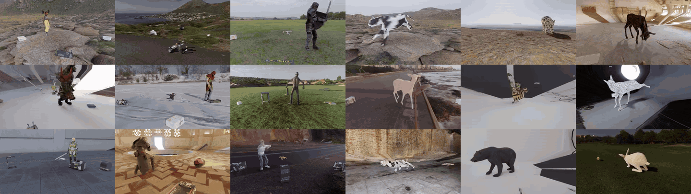

# Multi-View PointOdyssey

Code to generate multi-view synthetic datasets for 3D point tracking: humans and animals rendered from several static cameras, with ground-truth 3D trajectories and per-camera visibility.

This repository is built on the [PointOdyssey](https://github.com/y-zheng18/point_odyssey) data generation pipeline ([paper](https://arxiv.org/abs/2307.15055), [project page](https://pointodyssey.com/)), which in turn builds on [Kubric](https://github.com/google-research/kubric).



## Datasets

The datasets generated with this code are released on Hugging Face under CC BY 4.0, and are used to train and evaluate [Tracktail](https://arxiv.org/abs/2611.26779).

| Dataset | Link |
| --- | --- |
| Multi-View PointOdyssey, human | [ai-hhmi/mv-po-human](https://huggingface.co/datasets/ai-hhmi/mv-po-human) |
| Multi-View PointOdyssey, animal | [ai-hhmi/mv-po-animal](https://huggingface.co/datasets/ai-hhmi/mv-po-animal) |

## What is different from PointOdyssey

- Human and animal rendering and export scripts extended for multi-camera scenes, with ground-truth 3D trajectories and per-camera visibility (`render_human.py`, `render_animal.py`, `render_single.py`, `export_annotation_*.py`).
- Changes to trajectory generation and EXR output (`utils/gen_tracking.py`, `utils/openexr_utils.py`, `utils/file_io.py`).
- `extract_textures.py` extracts image textures from `.blend` files into per-asset folders.

## Setup

Install Blender 3.1+ (tested with 3.3.0) and the Blender add-ons used by the pipeline, then create the Python environment:

```
conda create -n point python=3.9
conda activate point
pip install -r requirements.txt
conda install -c conda-forge openexr-python
```

Required Blender add-ons (make sure they are available in `~/.config/blender/$VERSION/scripts/addons`):

* [Rokoko Studio Live Plugin for Blender](https://github.com/Rokoko/rokoko-studio-live-blender.git) (motion retargeting)
* [SMPL-X Blender Add-on](https://smpl-x.is.tue.mpg.de/) (human body model)
* [Stop Motion OBJ](https://github.com/neverhood311/Stop-motion-OBJ#stop-motion-obj) (importing mesh sequences)

### Assets

The generators read assets from a data folder (default `./data`, ignored by git). Following the PointOdyssey layout, you need:

* HDR environment maps (`hdri/`), e.g. from [Poly Haven](https://polyhaven.com/hdris)
* Camera data from [Mannequin Challenge](https://google.github.io/mannequinchallenge/www/index.html) (`camera_trajectory/MannequinChallenge`)
* 3D models from [PartNet](https://cs.stanford.edu/~kaichun/partnet/) and [GSO](https://research.google/resources/datasets/scanned-objects-google-research/) (`partnet/`, `GSO/`) used as distractor objects
* Humans: Mixamo characters (`robots_mixamo_blend/`) and AMASS motions converted to SMPL-X (`motions_smplx/`)
* Animals: [DeformingThings4D](https://github.com/rabbityl/DeformingThings4D) animal models and animations (`DeformingThings4D/animals/`), plus fur textures from [BlenderKit](https://www.blenderkit.com/) applied to the animal models (`animal_textures/`; `extract_textures.py` extracts them from the downloaded `.blend` files) and `blender_assets/animal_material.blend`
* `blender_assets/hdri_plane.blend`, the base scene

See the [PointOdyssey README](https://github.com/y-zheng18/point_odyssey#introduction) for details on obtaining the base assets.

## Usage

Each sequence is generated with one command. The scripts below render all cameras, extract depth, normals and segmentation from the EXR files, export the meshes, and write the ground-truth trajectories.

**Human sequences:**

```
python export_annotation_human.py \
    --output_dir results/hum0 \
    --character_root data/robots_mixamo_blend/ \
    --motion_root data/motions_smplx/ \
    --partnet_root data/partnet/data_v0/ \
    --gso_root data/GSO/ \
    --background_hdr_path data/hdri/ \
    --camera_root data/camera_trajectory/MannequinChallenge \
    --scene_root data/blender_assets/hdri_plane.blend \
    --rendering --exr --export_obj --export_tracking \
    --sampling_points 5000 --sampling_scene_points 2000 \
    --seed 0 --tracking_seed 0 \
    --views 9 --use_gpu --add_force --unified_tracking --use_static_cam
```

**Animal sequences:** use `export_annotation_animal.py` with `--animal_root data/DeformingThings4D/animals/`, `--animal_texture_root data/animal_textures/` and `--material_path data/blender_assets/animal_material.blend` in place of the human character and motion arguments.

Main arguments:

| Argument | Meaning |
| --- | --- |
| `--views N` | Number of cameras rendered per scene (9 for the released datasets). |
| `--use_static_cam` | Use fixed cameras placed around the subject instead of sampled Mannequin Challenge trajectories. |
| `--add_force` | Push objects around the scene with random forces (`--force_num`, `--force_step` and `--force_interval` control the forces). |
| `--max_frames N` | Render only the first N frames (omit for the full sequence). |
| `--unified_tracking` | Track one shared point set across all views, visible in at least one view, so trajectories correspond across cameras. |
| `--sampling_points`, `--sampling_scene_points` | Number of tracked points sampled on the subject and on the rest of the scene. |
| `--seed`, `--tracking_seed` | Seeds for scene generation and for point sampling (for reproducible tracks). |
| `--use_gpu` | Render on the GPU. |

To render many sequences on a cluster, run the exporter once per sequence index with a different `--seed`, for example with GNU parallel.

### Output

For each sequence, `--output_dir` contains:

```
<output_dir>/
├── scene.blend              # the Blender scene
├── obj/                     # exported meshes
├── cam/view{i}/             # per-frame camera files (RT_XXXX.txt, K_XXXX.txt)
├── view{i}/                 # one folder per camera
│   ├── images/              # RGB frames
│   ├── exr_img/             # depth, normals and masks extracted from EXR
│   └── annotations.npz      # ground-truth trajectories for this view
└── tracking_index_cache.npz # shared point indices (with --unified_tracking)
```

`annotations.npz` contains `trajs_2d` (per-frame pixel coordinates), `trajs_3d` (world coordinates), `visibilities`, `intrinsics` and `extrinsics`. See [utils/reprojection.py](./utils/reprojection.py) for camera conventions, coordinate systems and depth scales.

## Citation

If you use this code or the datasets, please cite Tracktail and PointOdyssey:

```
@article{tracktail2026,
  title   = {Tracktail: Multi-View 3D Point Tracking without Depth Input},
  author  = {Katie L. Rupp and Jonathan Wong and Sharmishtaa Seshamani and Ana Mafalda Vicente and Lili Karashchuk},
  journal = {arXiv preprint arXiv:2611.26779},
  year    = {2026},
  eprint  = {2611.26779},
  archivePrefix = {arXiv},
  url     = {https://arxiv.org/abs/2611.26779}
}

@inproceedings{zheng2023point,
  author    = {Yang Zheng and Adam W. Harley and Bokui Shen and Gordon Wetzstein and Leonidas J. Guibas},
  title     = {PointOdyssey: A Large-Scale Synthetic Dataset for Long-Term Point Tracking},
  booktitle = {ICCV},
  year      = {2023}
}
```

## License

The code in this repository is released under the MIT License (see `LICENSE`). It is derived from [PointOdyssey](https://github.com/y-zheng18/point_odyssey) (MIT, Copyright (c) 2024 PointOdyssey Authors) and contains code modified from [Kubric](https://github.com/google-research/kubric) (Apache 2.0), which remains under its original license. See `NOTICE.md` for details and `third_party/` for the original license texts. The generated datasets are released under CC BY 4.0.
